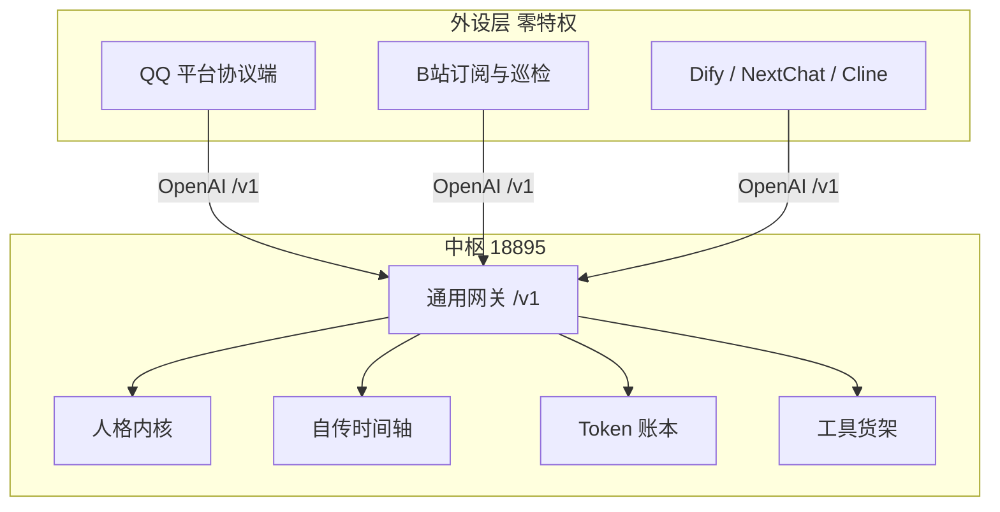

# Stellaris

> 一个只负责**人格、档案、记忆、模型路由与 Token 账本**的智能体中枢。
>
> 平台接入、外部工具执行、消息收发交给外部；中枢通过 OpenAI 兼容的 `/v1` 接口提供统一的大脑，并保留少量管理员系统工具。

```text
一处记忆，万物投射
中枢为脑，外设为肢
```

---

## 为什么做这个

现在每个 AI 工具都要自己配一套模型、一套 Prompt、一套 Key、一套记忆。换一个客户端，人格就断了，记忆也断了。

Stellaris 把这些收敛到一处：

| 目标 | 做法 |
|---|---|
| **统一 AI 入口** | 所有调用走同一个 `/v1` 网关，不各建模型 / Prompt / Key |
| **统一连续记忆** | 同一实体跨平台收敛到同一套 `person_id` / `archive_id` |
| **统一人格** | 人格、语气、关系温度、输出规则只有一套 |

## 架构



## 能力

### 通用网关

标准 OpenAI 格式，`/v1/chat/completions` 支持流式与非流式，`/v1/models` 返回模型列表。

入站注入人设、好感度、长期事实与相关记忆；出站去句末标点、写回时间轴、扣减账本。外部客户端只是一块显示屏。

### 工具货架

工具由外部提供，中枢只决定"给不给、给几个"。

```text
直接可用    每轮都注入
按需筛选    分类器判类后才给
需要提权    非管理员客户端拿不到
按档案配置  不同档案可用不同工具，陌生访客单独一组
```

### 档案系统

```text
archives            人物档案（含好感度浮动窗口）
user_profiles       好感度值 + 变化历史
user_facts          长期事实（AI 总结 / 人工填写）
archive_settings    用户自定义设定（AI 不可改）
```

好感度未定时显示 `?`，首次交流由模型评估初始值；之后每轮由模型给增量，并 clamp 在档案自己的窗口内。

### 自传时间轴

不是"聊天记录"，是**连续经历流**。

注入方式：整段时间轴按字数预算做曲线压缩（前段完整、后段压缩），
需要更早的记忆时由模型发起 `[[记忆检索]]` 深时检索（关键词 + 时间范围，含已归档事件）。
超出常驻预算的旧事件搬进缓冲区，不再占用上下文。

> 早期设计的「三维打分召回 + 单模块配额 + 向量」只在测试里跑，主路径没有接；
> 详见 [审计报告](docs/FUNCTION_REVIEW_20261101.md)。

时间轴展示拆成三个独立标签：

```text
[插件] [平台] [人员]
```

人员有档案时显示档案名，管理员/访客用颜色区分；没有档案才显示 UID。

### 记忆模块

```text
L1 单次调用上下文
L2 agent_timeline   连续经历 + 插件/档案/权限
L3 memory_details   长原文
   user_facts       长期事实
   memory_digests   摘要
   timeline_buffer  旧事件缓冲区
```

设置 → 记忆库可以查看占用、导出原生 JSON、一键导入 JSONL / ChatGPT / 纯文本。导入前自动备份。

### 功能挂载

外部工具仍由宿主执行；中枢只做分类、权限和结果压缩。

中枢原生系统工具是例外，由中枢本地执行：

```text
hub_host_control    宿主机备用控制
hub_ledger_query    只读账本查询
```

两者都只对管理员开放，并写审计。

### Token 账本

按「通道 + 工具」归因：

```text
哪个客户端、走的哪条通道、调了哪些工具、烧了多少 token、花了多少钱
```

主控凭证与执行凭证分开计价，跨币种不混加。

### 性能监控

```text
GPU         nvidia-smi 读利用率 / 显存 / 温度（没有显卡就跳过）
AI 进程     按进程名规则归类（AstrBot / Ollama / Host Bridge / 中枢本体…）
CPU / 内存  只统计命中的 AI 进程，不是整机占用
```

30 秒缓存，避免前端轮询把机器拖慢；没有 Docker 容器级指标。

## 快速开始

```bash
git clone https://github.com/leque2333/Stellaris.git
cd Stellaris
python -m venv .venv && source .venv/bin/activate   # Windows: .venv\Scripts\activate
pip install -r requirements.txt

python console/server.py 18895
```

然后浏览器打开 `http://127.0.0.1:18895`。

外部客户端接入：

```text
Base URL : http://<host>:18895/v1
API Key  : 在 data/clients.json 里签发
Model    : 当前活跃模型
Header   : X-Channel: <通道名>   X-User-Id: <实体 ID>
```

详细步骤见 [README](README.md)，接入平台见 [docs/ASTRBOT_SETUP.md](docs/ASTRBOT_SETUP.md)。

## 设计取舍

**中枢不做平台协议，也不执行外部工具。** 中枢没有 QQ SDK、没有浏览器；外部工具仍由宿主执行。

只有少数系统工具（宿主机备用控制、账本只读查询）由中枢本地执行，必须管理员身份 + 系统工具开关 + 审计。

好处是加一个新平台不用改中枢；代价是中枢永远是"半个人"，必须挂在一个外部端上才能说话。

**不做启发式判断。** 谁是主人、谁是访客、哪个是群、哪条消息算主动触发——全部显式配置，不靠模型猜。

**失败降级。** 工具裁剪、模型路由、好感度评估，任何一环挂了都放行，不让对话卡死。

## 文档

- [架构总览](docs/ARCHITECTURE.md)
- [记忆模块架构](docs/MEMORY_MODULE.md)
- [功能挂载架构](docs/FUNCTION_MOUNTING.md)
- [记忆分层](docs/MEMORY_LAYERS.md)
- [工具货架](docs/TOOL_SHELVES.md)
- [插件接入契约](docs/PLUGIN_ADAPTERS.md)
- [账本查询工具](docs/LEDGER_TOOL.md)
- [档案画像](docs/ARCHIVE_PROFILE.md)
- [身份映射](docs/IDENTITY_SCAN.md)
- [存储结构](docs/STORAGE.md)

## 许可证

[AGPL-3.0](LICENSE)

修改后的代码必须以相同许可证开源，包括以网络服务形式提供的情况。商业闭源使用需另行授权。
