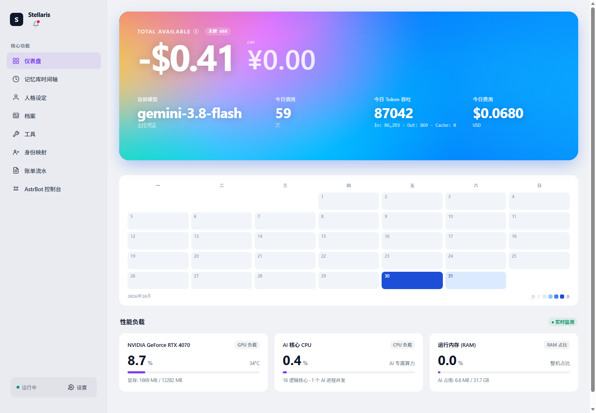
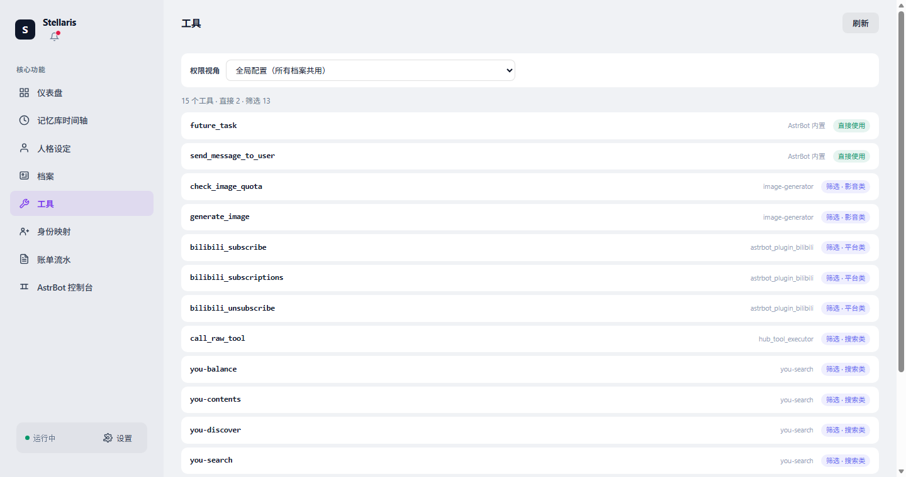
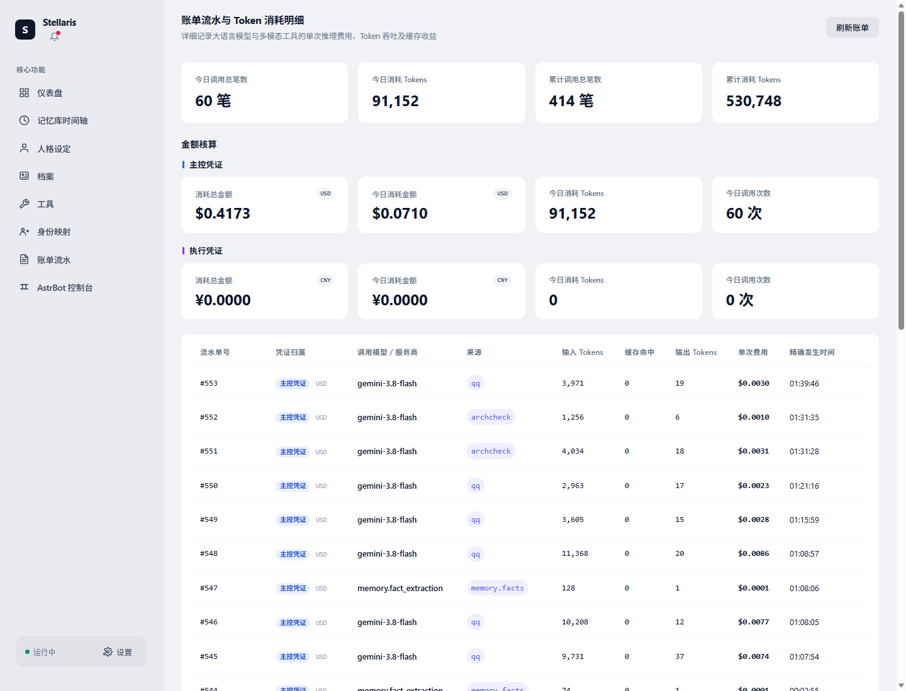

# Stellaris

> 一个只负责**人格、档案、记忆、模型路由与 Token 账本**的智能体中枢。
>
> 平台接入和工具执行交给外部；中枢通过 OpenAI 兼容的 `/v1` 接口提供统一的大脑。



## 快速开始

```bash
git clone https://github.com/leque2333/Stellaris.git
cd Stellaris
python -m venv .venv
source .venv/bin/activate        # Windows: .venv\Scripts\activate
pip install -r requirements.txt

python console/server.py 18895
```

打开 `http://127.0.0.1:18895`。

首次启动会自动建库、跑 schema 迁移，备份落在 `backups/`。

## 接入外部客户端

```text
Base URL : http://<host>:18895/v1
API Key  : 在 data/clients.json 里签发
Model    : 当前活跃模型
Header   : X-Channel: <通道名>   X-User-Id: <实体 ID>
```

任何支持 OpenAI 格式的客户端都能接：Dify、NextChat、Cline、各种 IDE 插件。

```bash
curl http://127.0.0.1:18895/v1/chat/completions \
  -H "Authorization: Bearer <你的 Key>" \
  -H "Content-Type: application/json" \
  -H "X-Channel: curl" -H "X-User-Id: 10001" \
  -d '{"model":"<当前模型>","messages":[{"role":"user","content":"你好"}]}'
```

## 界面

<details>
<summary>工具页 / 账单流水</summary>





</details>

## 想了解更多

完整的项目介绍、架构、能力清单和设计取舍见 [PROJECT_ARCHIVE.md](PROJECT_ARCHIVE.md)。

设计文档：

- [架构总览](docs/ARCHITECTURE.md)
- [记忆分层](docs/MEMORY_LAYERS.md)
- [工具货架](docs/TOOL_SHELVES.md)
- [档案画像](docs/ARCHIVE_PROFILE.md)
- [AstrBot 接入](docs/ASTRBOT_SETUP.md)
- [API 安全](docs/API_SECURITY.md)（本机访问限制 / 请求签名）
- [后续开发规范](docs/DEV_RULES.md)（改代码前先看这个）

## 测试

```bash
python -m unittest discover -s tests -t .
```

CI 在 Python 3.10 / 3.11 / 3.12 上跑一遍。依赖生产库的集成测试在干净环境会自动 skip。

## 参与

- 提交前跑测试，代码约定见 [CONTRIBUTING.md](CONTRIBUTING.md)
- 安全问题走 [SECURITY.md](SECURITY.md)，不要开公开 issue
- 版本变化见 [CHANGELOG.md](CHANGELOG.md)

## 许可证

[AGPL-3.0](LICENSE)

修改后的代码必须以相同许可证开源，包括以网络服务形式提供的情况。商业闭源使用需另行授权。
